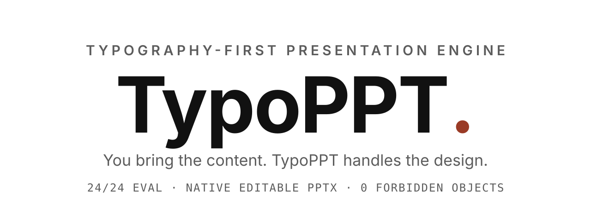
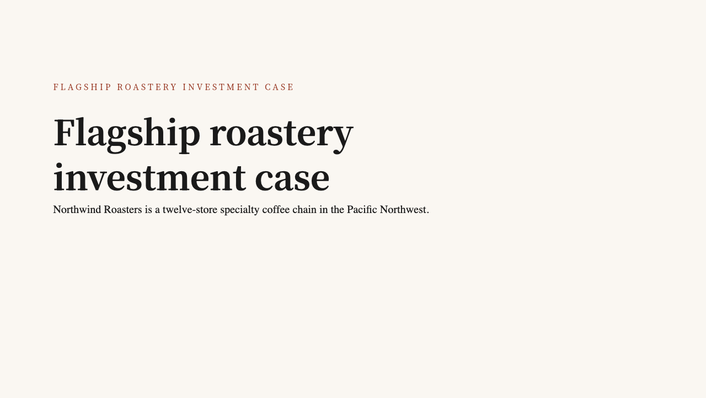
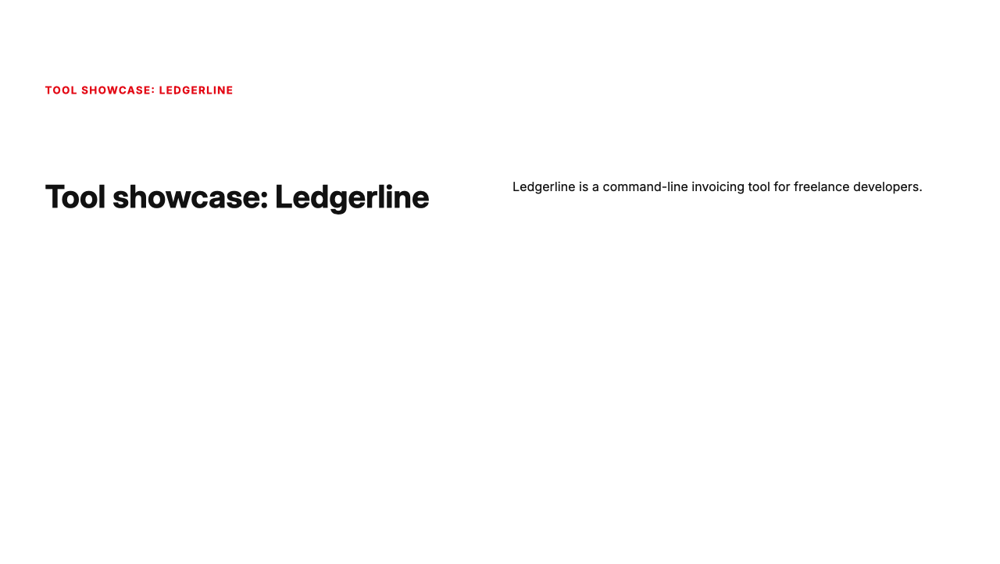
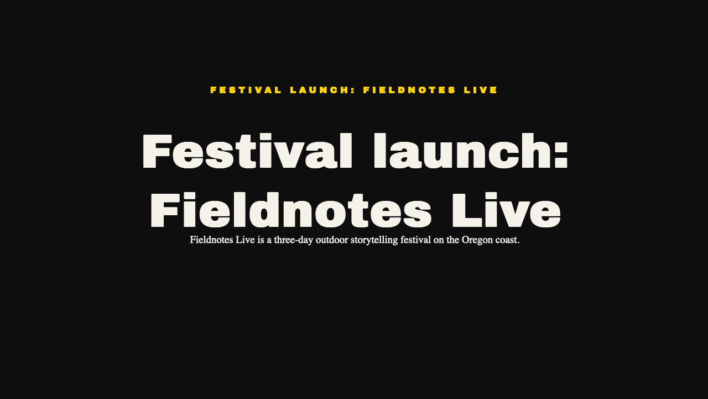
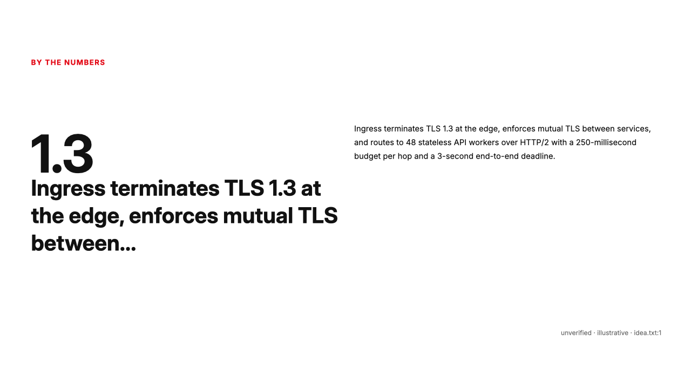

# TypoPPT

<picture>
  <source media="(prefers-color-scheme: dark)" srcset="brand/typoppt/typoppt-hero-dark.svg" />
  
</picture>

TypoPPT is a typography-first presentation engine for humans and coding agents.

*You bring the content. TypoPPT handles the design.*

Paste a product idea or a public GitHub repo. Get a 5–12 slide pitch deck as a real, editable `.pptx` — every number traces to a source, and there is nothing on the slides but type, numbers, whitespace, and color.

> **Naming note.** TypoPPT is the public product brand. Code identifiers are still `typodeck` (package names, CLI, skill name, Studio titles) until an explicit migration decision. This README uses TypoPPT for the product and `typodeck` for the identifiers — never mixed for the same thing.

```sh
git clone https://github.com/Hun-Bot2/Typodeck.git
cd Typodeck
npm ci
npm run build -w @typodeck/core   # required once: Studio API + CLI import dist/
npm run --silent deck -- --idea-file packages/core/fixtures/idea-f4.txt --system swiss --out deck.pptx
# deck: 10 slides, 40 text boxes -> deck.pptx
# validation: OK
```

Docs: [Agent Skill](plugins/typodeck/skills/typodeck/SKILL.md) · [Web Studio](#web-studio) · [Architecture](docs/ARCHITECTURE.md) · [FAQ](docs/FAQ.md) · [Contributing](CONTRIBUTING.md)

## Demo video

<!-- TYPOPPT-VIDEO: owner-recording integration point. See docs/media/VIDEO-INTEGRATION.md.
     Do not add a video URL or thumbnail here until real footage exists. -->

A real end-to-end walkthrough (skill invocation → deck → editable PPTX → Studio) is being recorded by the project owner. Until it lands, the screenshots below are the evidence: every one is rendered from genuine engine `.pptx` bytes. Storyboard and integration guide: [docs/media/VIDEO-RECORDING-GUIDE.md](docs/media/VIDEO-RECORDING-GUIDE.md).

## Actual output

These four decks were generated by the actual engine (`npm run deck` CLI) and rendered from the real `.pptx` bytes. Nothing is hand-drawn. See [docs/showcase/README.md](docs/showcase/README.md) for reproduce commands and editability proof.

| Editorial | Swiss |
|---|---|
|  |  |
| [readme-editorial.pptx](docs/showcase/readme-editorial.pptx) · 9 slides, 35 boxes | [readme-swiss.pptx](docs/showcase/readme-swiss.pptx) · 8 slides, 31 boxes |

| Expressive | Dense technical (Swiss, interior slide) |
|---|---|
|  |  |
| [readme-expressive.pptx](docs/showcase/readme-expressive.pptx) · 9 slides, 34 boxes | [readme-dense-technical.pptx](docs/showcase/readme-dense-technical.pptx) · 10 slides, 39 boxes |

All four runs: provider `fallback` (deterministic, no API key), idea mode so claims are labeled `ungrounded` and number slides carry `unverified · illustrative` captions. Deck JSON, provenance receipts, and idea inputs ship alongside each `.pptx`. Multi-slide sequences from live repos (12 slides each, pinned SHAs) live in [showcase/previews/](showcase/previews/) — see [showcase/manifest.md](showcase/manifest.md) for the manifest.

## Why TypoPPT?

Developers and presentation creators spend too much time manually arranging text, aligning objects, adjusting hierarchy, and rebuilding slides — and AI generators fill the gap with fabricated charts, uneditable pixels, and invented numbers.

TypoPPT reduces that work through one shared typography composition engine, governed by four rules enforced in code rather than promised in prose:

1. **Grounded, or labeled.** Factual claims print file path + line refs on the slide. Anything ungrounded is labeled `unverified` / `illustrative` / `proposal`.
2. **Editable down to the last character.** The exporter emits native text boxes only; a validator scans every `.pptx` for forbidden objects. Open it and rewrite any line.
3. **Deterministic.** A seeded layout engine places every box — no LLM in the geometry path. Same input reproduces the same layout JSON.
4. **Honest about provenance.** No live model endpoint has been verified, so every run uses the labeled deterministic fallback and says so in its receipt ([docs/MUSE_PROVIDER.md](docs/MUSE_PROVIDER.md)).

Typography-only is a deliberate constraint: decorative visuals are where generated decks smuggle in fabricated content. Details: [docs/PRD.md](docs/PRD.md), [docs/DESIGN_SYSTEM.md](docs/DESIGN_SYSTEM.md).

## Two ways to use TypoPPT

The Agent Skill and the Web Studio both drive the same core pipeline (`packages/core`). Pick the surface that fits; the deck mechanics never change.

### Agent Skill

In your coding agent:

> Create a technical presentation from this repository using TypoPPT.

Verified workflow: repository inspection → evidence → narrative → composition → validation → editable PPTX. The Skill first runs intent discovery ([references/intent.md](plugins/typodeck/skills/typodeck/references/intent.md)): it inventories what it already knows, asks at most one batched round of questions only for material gaps, and otherwise states its plan and proceeds — in English or Korean. It orchestrates Core through the CLI and ships only on `validation: OK`. Full reference: [SKILL.md](plugins/typodeck/skills/typodeck/SKILL.md).

### Web Studio

```sh
npm run dev   # Studio at http://localhost:3000
```

Provide content → inspect evidence → generate → select design → refine → export. The Studio adds an evidence inspector (review files + claims, exclude or reframe before generating), all-systems preview from one narrative, Slide Markdown editing with server-side re-render, an export theme picker (27 experimental template themes), and `.pptx` download. If `/api/generate` returns HTTP 500 with `Can't resolve '@typodeck/core'`, run the `build -w @typodeck/core` line once.

## Installation

Prerequisites: Node.js ≥20.9.0 and npm. `.env` is optional (model provider / GitHub auth only); without model credentials TypoPPT uses its labeled deterministic fallback.

| Agent | Install | Evidence |
|---|---|---|
| Muse Code | `muse skills validate plugins/typodeck/skills/typodeck` → `valid typodeck`; project: copy/symlink the skill dir to `.agents/skills/typodeck/` in a trusted workspace; personal: `muse skills install plugins/typodeck/skills/typodeck` | Verified live |
| Claude Code | Plugin via repo marketplace (`.claude-plugin/marketplace.json` → `./plugins/typodeck`); fallback: copy/symlink to `.claude/skills/typodeck/` (project) or `~/.claude/skills/typodeck/` (personal) | Documented, session load not live-tested |
| Codex | `.agents/skills/typodeck/` (project) or `$CODEX_HOME/skills/typodeck/` (personal) | Documented, session load not live-tested |
| Other agents | Check out the repo and point the agent at [SKILL.md](plugins/typodeck/skills/typodeck/SKILL.md) (shell + HTTP only, no harness calls) | Untested per-tool |

No verified Cursor/Windsurf/Copilot path exists — the generic fallback above is untested there. Full matrix with evidence levels: [INSTALL.md](plugins/typodeck/skills/typodeck/INSTALL.md).

Verify any install with the worked transcript (7 examples, exit 0; skips honestly without network/quota):

```sh
bash plugins/typodeck/skills/typodeck/EXAMPLES.sh /tmp/typodeck-skill
```

## How it works

```
input → understanding → slide IR → typography engine → visual validation → export
```

| Stage | Module | Responsibility |
|---|---|---|
| ingestion | `src/ingestion.ts` | Bounded repo fetch (≤20 files, ≤200 KB, 30 s, public only) or pasted-text accept; typed errors |
| evidence | `src/evidence.ts` | Atomic claims; `verified` / `suggestion` / `ungrounded`; verbatim numbers |
| narrative | `src/narrative.ts` | 5–12 slide outline, purpose presets (P01–P10), compact captions |
| layout | `src/layout.ts` + `src/systems.ts` | Seeded deterministic geometry per visual system; no LLM in path; numeral render guard; CJK-aware measurement |
| export | `src/export.ts` | `addText`-only `.pptx`; slide background fill; run locale (`ko-KR`/`en-US`); nothing else |
| validation | `src/validate.ts` | Forbidden-object scan, bounds, editability floor — every export |

No database, no auth, no cloud services. Studio API: `POST /api/evidence` (inspect), `POST /api/generate` (JSON or SSE stages), `POST /api/markdown` (re-render from edited Slide Markdown), `POST /api/export` (re-lays-out server-side; client geometry never trusted; optional experimental `template` slug), `GET /api/catalog`, `GET /api/templates`. Details: [packages/core/README.md](packages/core/README.md), [docs/ARCHITECTURE.md](docs/ARCHITECTURE.md).

## Design philosophy

- **Typography-first.** Editable text, numbers, whitespace, and color carry the deck. Rectangles, borders, icons, images, charts, gradients, and shadows are refused — by the validator, not by convention.
- **Intentional hierarchy.** One thesis per slide; kicker/title/body/number/caption roles with fixed scale tokens and contrast ≥4.5:1.
- **Content-aware composition.** A composition grammar scores candidate arrangements per slide role; purpose presets shape the narrative arc.
- **Controlled diversity.** Three production systems plus one experimental, all from one narrative so previews are directly comparable:

| System | Status | Voice |
|---|---|---|
| Editorial | production | Asymmetric single column, serif titles, generous whitespace |
| Swiss | production | Four-column grid, tight leading, title left / text right |
| Expressive | production | Centered hero, dramatic scale contrast, alternating ink/paper |
| Document | experimental | Dense reference hierarchy — excluded from production guarantees |

- **Experimental themes.** 27 template-pack designs (`make-deck --list-templates`, Studio export picker, `GET /api/templates`) re-theme a base system's geometry with template fonts/colors. The HTML specimens are design references — themed output is base-system geometry, honestly labeled experimental.
- **Visual validation.** Structural gates on every export (0 forbidden objects, in-bounds, 16:9); a numeral render guard sizes hero figures against measured single-spacing so rendered ink fits its box; Korean decks get `ko-KR` run locale, KR-capable faces, and line head/end restrictions.
- **Native editability.** Every character lives in a native text box. Spec: [docs/DESIGN_SYSTEM.md](docs/DESIGN_SYSTEM.md).

## Supported outputs and limitations

- **Native editable PPTX** (16:9, 13.33×7.5 in): verified. The four showcase decks hold 139 editable text nodes with 0 mismatches and 0 forbidden elements; the eval matrix reports 100% text editability and 0 overflowing boxes ([evals/summary.json](evals/summary.json), 24/24 runs).
- **HTML previews**: Studio canvas and comparable per-system previews. HTML is not PPTX proof — judge the `.pptx` files.
- **No PDF export**, no collaboration, no images/icons/charts/tables/animations — by design.
- **Public repos only**; unauthenticated GitHub calls share hourly quota — exhaustion fails fast as typed `rate-limited`. Idea mode works fully offline.
- **KO/EN only.** Korean support covers run locale, KR faces, CJK-aware measurement, and line restrictions (see [evals/hackathon/ko-typography.md](evals/hackathon/ko-typography.md)); keep-all phrasing and width-based caps remain follow-ups. Font-embedding licenses are not yet fully verified — check before redistributing decks commercially.
- **Rendering**: box geometry is validated structurally; rendered line breaks were measured on macOS QuickLook only — no native PowerPoint/Keynote render compare exists. Open the showcase files in your target app before judging fidelity.
- **Not claimed**: no human-preference wins, no benchmark score (the blind A/B protocol is defined but unexecuted — zero ballots exist). The deterministic fallback guarantees grounding mechanics, not prose quality. `.pptx` bytes vary run to run (embedded timestamps); determinism covers layout JSON, not zip bytes.

More: [docs/FAQ.md](docs/FAQ.md), [docs/PRD.md](docs/PRD.md) §7 (out of scope).

## Contributing and license

See [CONTRIBUTING.md](CONTRIBUTING.md). Short version: strict TypeScript, `node --test` suites beside the code, injectable `fetch` so tests never touch the network, typed errors with stable codes, and every `.pptx` must pass the structural validator.

```sh
npm test                          # build core, then node --test — must be all green (575 tests)
npm run eval -- --fixture F4      # offline eval subset; full matrix needs GitHub quota
npm run journey                   # live repo→deck→export end-to-end (needs quota; exits 2 without)
```

Repository layout:

```
packages/core/   Pipeline: ingestion, evidence, narrative, layout, export, validation, CLI, eval
apps/web/        Web Studio (Next.js): evidence inspector, SSE progress, preview, .pptx download
plugins/typodeck/ Claude plugin + Agent skill: CLI-first workflow, grounding rules, worked examples (EXAMPLES.sh)
evals/           Pinned fixtures, per-run reports, summary.json
docs/            Specs, audits, research, ADRs (docs/engineering/decisions/), log
brand/typoppt/   TypoPPT public brand assets (SVG); brand/typodeck-* is the code identity
docs/showcase/   Real engine decks for this README (PPTX + PNG + JSON + provenance)
docs/media/      Demo video recording + integration guides
```

Brand: [brand/typoppt/README.md](brand/typoppt/README.md). Reference research: [docs/REFERENCE_ANALYSIS.md](docs/REFERENCE_ANALYSIS.md).

MIT — see [LICENSE](LICENSE). Copyright (c) 2026 Nam Jeong Hun.
