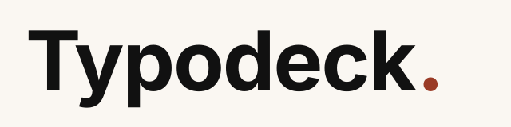

# Typodeck

<picture>
  <source media="(prefers-color-scheme: dark)" srcset="brand/typodeck-wordmark-dark.svg" />
  
</picture>

Typodeck — A typography-first presentation engine for humans and coding agents.

*You bring the content. Typodeck handles the design.*

Paste a product idea or a public GitHub repo. Get a 5–12 slide pitch deck as a real, editable `.pptx` — every number traces to a source, and there is nothing on the slides but type, numbers, whitespace, and color.

## Real output

These four decks were generated by the actual engine (`npm run deck` CLI) and rendered from the real `.pptx` bytes. Nothing is hand-drawn. See [docs/showcase/README.md](docs/showcase/README.md) for reproduce commands and editability proof.

| Editorial | Swiss |
|---|---|
|  |  |
| [readme-editorial.pptx](docs/showcase/readme-editorial.pptx) · 9 slides, 35 boxes | [readme-swiss.pptx](docs/showcase/readme-swiss.pptx) · 8 slides, 31 boxes |

| Expressive | Dense technical (Swiss) |
|---|---|
|  |  |
| [readme-expressive.pptx](docs/showcase/readme-expressive.pptx) · 9 slides, 34 boxes | [readme-dense-technical.pptx](docs/showcase/readme-dense-technical.pptx) · 10 slides, 39 boxes |

All four runs: provider `fallback` (deterministic, no API key), idea mode so claims are labeled `ungrounded` and number slides carry `unverified · illustrative` captions. Deck JSON, provenance receipts, and idea inputs ship alongside each `.pptx` in [docs/showcase](docs/showcase/README.md).

## What it does

Typodeck turns one of two inputs into a typography-only deck:

- **Idea mode** — paste 100–20,000 characters of product description. All claims are labeled `ungrounded`; numbers are copied verbatim, never computed, never invented.
- **Repo mode** — give a public `owner/repo`. Typodeck fetches README/docs plus a bounded code sample (≤20 files, ≤200 KB, 30 s timeout) and extracts atomic claims with file-and-line refs. Code-backed claims are `verified`; README/docs claims stay `suggestion` until code confirms them. Private repos are rejected with a typed error.

Then: claims → 5–12 slide outline (one thesis per slide) → deterministic layout in your chosen system → `.pptx` export → structural validation. Number slides are built only from claims carrying both a number and a source ref.

Four rules, enforced in code rather than promised in prose:

1. **Grounded, or labeled.** Factual claims print file path + line refs on the slide. Anything ungrounded is labeled `unverified` / `illustrative` / `proposal`.
2. **Editable down to the last character.** The exporter emits native text boxes only; a validator scans every `.pptx` for forbidden objects. Open it and rewrite any line.
3. **Deterministic.** A seeded layout engine places every box — no LLM in the geometry path. Same input reproduces the same layout JSON.
4. **Honest about provenance.** No live model endpoint has been verified, so every run uses the labeled deterministic fallback and says so in its receipt ([docs/MUSE_PROVIDER.md](docs/MUSE_PROVIDER.md)).

Typography-only is a deliberate constraint: decorative visuals are where generated decks smuggle in fabricated content (fake charts, stock metaphors) and uneditable pixels. Details: [docs/PRD.md](docs/PRD.md), [docs/DESIGN_SYSTEM.md](docs/DESIGN_SYSTEM.md), [docs/FAQ.md](docs/FAQ.md).

## Two interfaces, one engine

The agent Skill and the Web Studio both drive the same core pipeline (`packages/core`). Pick the surface that fits; the deck mechanics never change.

| Interface | Entry point | Best for |
|---|---|---|
| Agent Skill | [skills/typodeck/SKILL.md](skills/typodeck/SKILL.md) | Agentic decks from your coding assistant — the Skill orchestrates Core (CLI/API) and never lays out slides itself |
| Web Studio | `npm run dev` → `http://localhost:3000` | Evidence inspection, Slide Markdown editing, visual preview, `.pptx` download |

The Studio adds an evidence inspector (review files + claims, exclude or reframe before generating), all-systems preview from one narrative, Slide Markdown editing with server-side re-render, and `.pptx` download. The Skill adds purpose presets, composition planning, and critic/revision loops on top of the same functions. Neither invents its own geometry: the Studio server re-lays-out from the posted narrative, and the Skill ships only on `validation: OK`.

A CLI (`npm run deck -- …`) underlies both — scripts, evals, and reproducible one-shot decks.

## Quickstart

Prerequisites: Node.js ≥20.9.0 and npm. No other system dependencies. `.env` is optional (model provider / GitHub auth only); without model credentials Typodeck uses its labeled deterministic fallback.

```sh
git clone https://github.com/Hun-Bot2/Typodeck.git
cd Typodeck
npm ci
npm run build -w @typodeck/core   # required once: Studio API + CLI import dist/
npm run --silent deck -- --idea-file packages/core/fixtures/idea-f4.txt --system swiss --out deck.pptx
# provider: fallback (generated_by=fallback)
# deck: 10 slides, 40 text boxes -> deck.pptx
# validation: OK
```

Web Studio:

```sh
npm run dev   # Studio at http://localhost:3000
```

Flow: paste a repo URL or idea → **Inspect evidence** → optionally exclude/reframe claims → **Generate** → pick a purpose preset + language → preview all systems → edit Slide Markdown → **Download `.pptx`**. If `/api/generate` returns HTTP 500 with `Can't resolve '@typodeck/core'`, run the `build -w @typodeck/core` line once.

## Skill install & usage

The Skill is a portable project skill — checkout-and-point, no installer, marketplace, or registry:

1. Check out this repo (same clone as above).
2. Point your agent at [skills/typodeck/SKILL.md](skills/typodeck/SKILL.md). It loads as a project skill in Muse Code, Codex, and Claude Code (`SKILL.md` + Markdown guides + `EXAMPLES.sh`; shell + HTTP only, no harness calls).
3. The Skill builds Core once, runs `deck --idea-file|--repo --system`, reads the provider/claims/deck/validation receipt, and ships only on `validation: OK`.

Verify with the worked transcript (idea + live repo + offline eval; skips honestly without network/quota):

```sh
bash skills/typodeck/EXAMPLES.sh /tmp/typodeck-skill
# exit 0
```

Skill reference: [skills/typodeck/SKILL.md](skills/typodeck/SKILL.md).

## Outputs & editability

Every run produces an editable `.pptx` (16:9, 13.33×7.5 in) plus a machine receipt. The exporter emits native `addText` text boxes and slide background fills only — speaker notes pass through untouched to the native notes part.

Editability is verified, not asserted: the validator unzips each `.pptx` and asserts zero pictures/charts/tables/groups/gradients, rect-only in-bounds shapes, and editable `a:t` character counts. The four showcase decks hold 139 editable text nodes with 0 mismatches and 0 forbidden elements ([docs/showcase/README.md](docs/showcase/README.md)). The committed eval matrix reports 100% text editability and 0 overflowing boxes ([evals/summary.json](evals/summary.json), [docs/EVALUATION.md](docs/EVALUATION.md)).

Companion artifacts: deck geometry JSON + provenance JSON (seed, claims, validation), HTML previews per system, and eval reports.

## Design systems

Three production systems plus one experimental. Same facts, materially different composition.

| System | Status | Voice |
|---|---|---|
| Editorial | production | Asymmetric single column, serif titles, generous whitespace |
| Swiss | production | Four-column grid, tight leading, title left / text right |
| Expressive | production | Centered hero, dramatic scale contrast, alternating ink/paper |
| Document | experimental | Dense reference hierarchy, technical-manual voice — excluded from production guarantees |

Fixed palettes, role tokens (kicker/title/body/number/caption), contrast ≥4.5:1, margins ≥0.5 in. The Studio lays out all systems from one narrative so previews are directly comparable. Spec: [docs/DESIGN_SYSTEM.md](docs/DESIGN_SYSTEM.md).

## Architecture

```
ingestion → evidence → narrative → layout → export → validation
```

| Stage | Module | Responsibility |
|---|---|---|
| ingestion | `src/ingestion.ts` | Bounded repo fetch or pasted-text accept; typed errors |
| evidence | `src/evidence.ts` | Atomic claims; `verified` / `suggestion` / `ungrounded`; verbatim numbers |
| narrative | `src/narrative.ts` | 5–12 slide outline, purpose presets (P01–P10), compact captions |
| layout | `src/layout.ts` + `src/systems.ts` | Seeded deterministic geometry per visual system; no LLM in path |
| export | `src/export.ts` | `addText`-only `.pptx`; slide background fill; nothing else |
| validation | `src/validate.ts` | Forbidden-object scan, bounds, editability floor — every export |

No database, no auth, no cloud services. Studio API: `POST /api/evidence` (inspect), `POST /api/generate` (JSON or SSE stages), `POST /api/markdown` (re-render from edited Slide Markdown), `POST /api/export` (re-lays-out server-side; client geometry never trusted), `GET /api/catalog` (system registry). Details: [packages/core/README.md](packages/core/README.md), [docs/ARCHITECTURE.md](docs/ARCHITECTURE.md).

## Examples

All executed on this baseline; expected receipts shown.

**Idea → deck (offline, no network):**

```sh
npm run --silent deck -- --idea-file packages/core/fixtures/idea-f4.txt --system editorial --out idea.pptx
# deck: 10 slides, 40 text boxes -> idea.pptx
# validation: OK
```

**Repo → deck (needs network + GitHub quota):**

```sh
npm run --silent deck -- --repo sindresorhus/is --system swiss --out is.pptx
# claims: total=56 verified=47 suggestion=9 ungrounded=0
# deck: 10 slides, 37 text boxes -> is.pptx
# validation: OK
```

**Purpose-aware narrative (one of 10 presets, P01–P10):**

```sh
npm run --silent deck -- --idea-file packages/core/fixtures/idea-f4.txt --preset P04 --system expressive --out pitch.pptx
# validation: OK
```

**Fixed samples (one 7-slide deck per system, all four):**

```sh
npm run --silent samples
# editorial: 7 slides, 24 text boxes, validation OK
# swiss: 7 slides, 24 text boxes, validation OK
# expressive: 7 slides, 24 text boxes, validation OK
# document: 7 slides, 24 text boxes, validation OK
```

**Offline eval subset (no network needed):**

```sh
npm run --silent eval -- --fixture F4
# matrix: 8/8 runs succeeded in ~100ms (seed=42)
```

## Limitations & status

- Public repos only; unauthenticated GitHub calls share hourly quota — exhaustion fails fast as typed `rate-limited` with a reset time. The Studio offers pasted-text idea mode as an offline fallback.
- Typography only, by design: no images, icons, charts, tables, shapes, or animations. No PDF export, no collaboration.
- KO/EN only. Font-embedding licenses are not yet fully verified — check before redistributing decks commercially.
- The deterministic fallback guarantees grounding mechanics, not prose quality.
- `.pptx` bytes vary run to run (embedded timestamps); the determinism guarantee covers layout JSON, not zip bytes.

Measured status: core test suite green; committed eval matrix 24/24 runs (4 fixtures × 2 languages × 3 production systems, seed 42) with 100% editability, 0 forbidden objects, 0 overflowing boxes — source [evals/summary.json](evals/summary.json), procedure [docs/EVALUATION.md](docs/EVALUATION.md). **Not** claimed: no human-preference wins, no 90+ benchmark score (the blind A/B protocol is defined but unexecuted — zero ballots exist), and no pixel proof that HTML previews match PPTX rendering. Judge the `.pptx` files.

More: [docs/FAQ.md](docs/FAQ.md), [docs/PRD.md](docs/PRD.md) §7 (out of scope), [docs/GITHUB_JOURNEY.md](docs/GITHUB_JOURNEY.md) (journey limits).

## Contributing

See [CONTRIBUTING.md](CONTRIBUTING.md). Short version: strict TypeScript, `node --test` suites beside the code, injectable `fetch` so tests never touch the network, typed errors with stable codes, and every `.pptx` must pass the structural validator (0 forbidden objects, all boxes in-bounds, 16:9).

```sh
npm test                          # build core, then node --test — must be all green
npm run eval -- --fixture F4      # offline eval subset; full matrix needs GitHub quota
npm run journey                   # live repo→deck→export end-to-end (needs quota; exits 2 without)
```

Repository layout:

```
packages/core/   Pipeline: ingestion, evidence, narrative, layout, export, validation, CLI, eval
apps/web/        Web Studio (Next.js): evidence inspector, SSE progress, preview, .pptx download
skills/typodeck/ Agent skill: CLI-first workflow, grounding rules, worked examples (EXAMPLES.sh)
evals/           Pinned fixtures, per-run reports, summary.json
docs/            Specs, audits, research, ADRs (docs/engineering/decisions/), log
brand/           Brand identity SVGs (illustrations, not engine output)
docs/showcase/   Real engine decks for this README (PPTX + PNG + JSON + provenance)
```

Brand: [docs/BRAND.md](docs/BRAND.md) (short spec), [brand/README.md](brand/README.md) (full asset docs).

## License

MIT — see [LICENSE](LICENSE). Copyright (c) 2026 Nam Jeong Hun.
